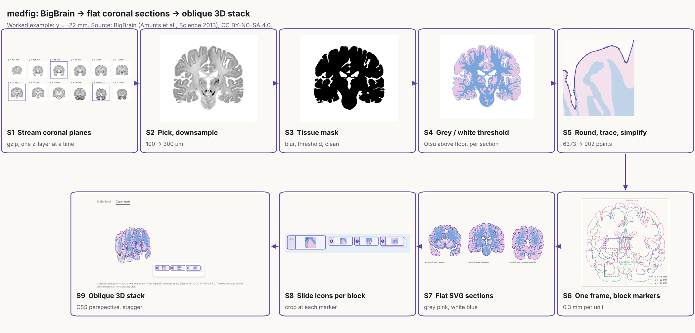

# medfig

Flat coronal brain figures from BigBrain, and an oblique 3D stack of three sections for a web page.
Method, figures and parameters: `report/report.pdf`.



## Quick start

```bash
scripts/dgx_setup.sh          # venv, packages, Chromium, data checksum, tests
. .venv/bin/activate
make all                      # out/ (SVG, HTML) and build/fig/ (figures), then report/report.pdf
open out/stack.html           # or serve out/ and open stack.html: Slide-level / Case-level switch
```

| Target | Product |
|---|---|
| `make sections` | `out/section_{1,2,3}.svg`, `out/sections.json` |
| `make icons` | `out/slide_one.svg`, `out/slide_strip.svg` |
| `make web` | `out/stack.html`, `out/stack.css`, `out/stack_snippet.html` |
| `make figures render overview` | `build/fig/*.png`, `build/frames/` |
| `make gif` | `build/stack.gif` |
| `make report` | `report/report.pdf` |
| `make test` | 5 checks, including a match with the SVGs on the lab landing page |
| `make extract VOLUME=...` | a new planes file from the full BigBrain volume |
| `make site SITE=dir` | copy the SVGs into a host site and print the markup and CSS |

## Inputs

- `config/sections.json`: every parameter (planes, blocks, thresholds, smoothing, palette, 3D stack).
- `data/bigbrain_coronal_100um_sel.npz`: 12 coronal planes cut from BigBrain (10 MB). See `data/README.md`.

## Licence

The figures are adapted from BigBrain (Amunts et al., Science 2013) and are under CC BY-NC-SA 4.0.
Keep the credit line: "Brain sections drawn from BigBrain (Amunts et al., Science 2013), CC BY-NC-SA 4.0".
The sections and blocks are a schematic. They are not the BU cutting plan or BU block locations.
